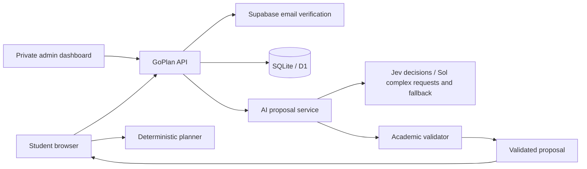

# Architecture

The hybrid decision flow is documented in [HYBRID_ARCHITECTURE.md](HYBRID_ARCHITECTURE.md).
When enabled, routine choices use Jev, while GoPlan validates and schedules the
result. Sol remains available for complex requests and fallback. Luna handles
explicit research refreshes; routine opportunity matching uses reviewed evidence.

## Recommendation boundary

The questionnaire stores ordered choices in `questionnaireRankings` alongside readable answers. The shared vocabulary validates the signal at the browser and server boundaries. Earlier choices receive higher relevance weights; the model receives the same order for academic choices. Eligibility rules, explicit constraints, recorded study and the latest requested edit take precedence. Reordering invalidates cached advice. An explicit global preference edit clears the old ranking for that answer.

Complete research evidence is reused for matching requests within the existing 15-minute cache lifetime. Incomplete evidence still follows the research path, and changed preferences, rankings, refinements, profile or target history change the cache key. This avoids repeated search/extraction without reducing the reasoning level, evidence checks or academic validation. First-time provider latency remains variable.

The model proposes decisions; it does not write directly to a student's saved roadmap. Academic choices are bounded by the reviewed dataset and checked after generation. The scheduler computes semester placement using prerequisites, credit caps and recorded progress. A changed roadmap is previewed before acceptance. At most one repair within the shared time and spending budget corrects rejected proposals; network failure does not produce fabricated advice. Terminal initial Courses/Pace failures can continue using degree rules and the chosen load; initial opportunity failures use supported, profile-ranked reviewed records. Explicit AI revisions still report failure without claiming a change.

## Academic sources

Program-specific corrections in `dist/academic-corrections.js` take precedence over conflicting generic catalogue conditions. The BSEMS Materials Science rule uses CHE1402 only; the generic EGR2412 corequisite is excluded for that program following the course-sequence and portal check. Corrections are applied to planner rows, restored personal plans, course details and model contexts, including selectable catalogue options. Saved semesters, course selections and progress are preserved. A corequisite elsewhere may be completed earlier or taken concurrently; it does not force the courses into the same semester.

The applicable curriculum’s program sheet takes priority for explicit requirements, course choices, prerequisites and titles. The catalog fills facts the applicable sheet does not specify. Historical curricula do not overwrite newcomer requirements; explicit delegation of a minor to its providing school is preserved. Structured rules drive both scheduling and the course-details UI. The planner never appends supplementary prerequisite rows. Dependencies are allocated to unfilled, eligible free-elective slots with matching credits, retaining their own prerequisites and normal elective approval conditions. This never changes the degree course count or credit allocation. If an existing saved plan has filled those slots, a minimal replacement is offered as a draft; completed/current electives stay fixed. Unmet dependencies stay subject to normal validation. Older automatic rows are removed when a workspace is loaded, while any recorded study is retained outside the degree allocation.

## Research boundary

GPT-6 Luna runs focused native Responses web search without extra reasoning, required tool use, a low search context and at most four tool calls. Academic direction uses reviewed evidence unless live market refresh is explicitly enabled. Search and extraction share a 60-second budget; the complete request is limited to 180 seconds. Exact token counting and conservative reservations guard $0.25 of planned spending, including repairs; target ranking uses the standard tier. There are no automatic paid transport retries. D1 leases prevent simultaneous requests for the same authenticated student across Worker instances. Only completed web-search items establish consulted URLs. The server reads those public pages without provider credentials, validates redirects and exact short support fragments, then extracts facts under a strict JSON schema. Search prose alone is not a source receipt. Failed pages and unsupported claims are excluded. Exchange research enriches reviewed partner IDs without creating partnerships or confirming nomination. Raw search text and page bodies never enter the student response.

Opportunity matching ranks the reviewed eligible pool using public interests, strengths, focus and minor. Broad records do not gain priority merely by listing many sectors; comparable candidates are spread across sectors and countries. The model receives at most 24 internship candidates and 20 exchange candidates, with relevance hints. Research considers up to four profile-ranked partner records instead of the first two in source order, discovers up to four companies and retains up to three partner updates. The four-tool-call research limit and US$0.25 request guard remain enforced. New exchange records inherit their original AUI list term, scheme and restrictions; an academic-page review does not confirm a current exchange place. Workspace history stores up to 200 suggested public target IDs per category so repeated alternative requests do not cycle through the same names. Unaffected categories keep their IDs, order and explanations. Unseen eligible targets take priority until the pool is exhausted, including the last few remaining choices; current cards are avoided next when earlier suggestions must be reused. The second focus participates in matching, and startup preferences apply only to internships. The reviewed pool contains 92 Moroccan targets and 38 already-listed exchange institutions, with each undergraduate degree supporting at least three distinct shortlists of five. No cross-student identity or popularity tracking is used.

The research-only API (`researchOnly: true`) sends `researchOnly: true` for the existing step. It refreshes supporting evidence without running the recommendation model or changing degree choices, course selections, study pace, shortlist order or recommendation explanations. Verified findings are retained for 15 minutes under hashed criteria keys, with at most 64 cache entries per memory/DB store. The D1 evidence cache is created automatically and contains retained findings rather than questionnaires or raw page bodies. The server retains partial-research diagnostics. The student dashboard shows concise opportunity cards with an availability caveat; it does not expose provider diagnostics or research retry controls. On retry, verified categories and exchange institutions already checked are skipped. New recommendations remain an explicit separate action.

## Workspace boundary

Newcomers enter through three quick-choice cards, then five guided stages: Direction, Courses, Companies, Exchanges and Semesters. Each stage includes its initial recommendation and two structural AI change prompts. A stage change calls only its known adviser stage. Finishing all five unlocks the dashboard review and first save; saving unlocks five global structural prompts. A global edit router can execute at most five backend advice requests to produce a reviewable draft. Unused stage prompts do not carry over.

Returning students open their saved dashboard directly. They can edit degree, focus and minor without repeating onboarding, record course completion or current study, add, remove, replace or move any course from the available AUI catalogue, record a language requirement as completed, add or remove empty semesters and keep semester notes. Personal edits preserve explicit course placements, additions, removals, progress and semester notes across later settings/degree previews. The original saved plan remains available through Keep saved plan until a preview is saved. Manual additions are personal choices, not a university equivalency or registration approval. New account onboarding does not accept prior university study.

The dashboard exposes one saved plan and direct edits. There is no start-over action or second-roadmap creation. The separate course-unavailable AI control is retired. Only the principal Your space prompt starts a global AI change; manual edits and exports remain available at zero allowance. Explanations open on demand instead of repeating across cards. Course groups distinguish general education, common and major core, specialization, minor and elective requirements; each course links to its actual saved semester. Course details show resolved requirements only, omitting empty descriptions.

A workspace contains the planning decisions, saved and draft plans, progress and a small revision history. The server derives the owner from its authenticated session. Updates include an expected revision; a stale revision returns a conflict rather than overwriting newer work. Browser recovery copies are keyed by the verified account and workspace. They are not the authoritative cross-device store.

## Service allowance boundary

The shared service policy defines five initial recommendations, ten stage changes and five global changes. Each backend advice request shares the existing $0.25 conservative request guard. A global prompt can make at most five such requests. The full allowance therefore budgets up to 40 requests, or $10 in AI/API spending; a 20% markup produces an illustrative $12 one-time university fee. This is a guarded allowance budget, not a measured average or an all-expenses business cost. Hosting and support are excluded; no payment processing is implemented.

D1 stores verified-account allowance counters, action reservations and response receipts. Conditional updates and batched inserts enforce limits under concurrent requests. The browser cannot reset counters by changing workspace JSON, reloading or opening another device. Receipts replay an identical completed request without another paid model call; failed or unaccepted submissions still use their allowance. A completed stage cannot issue new stage calls. Existing saved roadmaps open directly with the five global changes. Manual editing and export do not require an AI action. A request locks all controls until it finishes; repeated clicks reuse the same operation. Failed global rebuilds restore the previous usable panel and saved plan. Lost initial Courses/Pace results replay their durable receipt after reload, and missing map drafts rebuild locally. The authenticated /api/reviewed-targets endpoint recovers supported missing opportunity lists without buying another generation or resetting an allowance. Account deletion removes private response receipts while retaining hashed allowance records to prevent resets.

## Authentication boundary

A same-origin request asks Supabase to send an email code. GoPlan verifies the submitted code with Supabase, checks the confirmed email, and issues a five-minute HttpOnly setup cookie. A hashed, single-use database ticket gates password creation through Supabase. Normal sign-in uses Supabase password authentication; GoPlan then creates a random 256-bit session. Password resets revoke existing GoPlan sessions. Passwords and provider refresh tokens are never stored by GoPlan. Only a hash is stored in the database; the browser receives an HttpOnly, SameSite=Lax cookie with Secure enabled on HTTPS. Sessions expire after 30 days and are revoked on sign-out or GoPlan-data deletion. Temporary hashed rate-limit buckets bound email sends and verification attempts.

Legacy profiles are reconnected only after the same email is verified, and only when exactly one matching profile exists. The client cannot select another owner ID. The administrative allowlist is environment configuration, not frontend code. ChatGPT identity headers are not trusted by the new authentication path.

## Feedback and analytics

Student mistake reporting and its HTTP review routes are retired (410 FEATURE_REMOVED), including in older clients. The owner inbox and its reporting routes are retired too; analytics no longer counts historical reports. Earlier private report records retain their original expiry and consent boundaries. Only previously opted-in verified corrections can enter advice context. No migration deletes historical user data. Daily operation counters contain no questionnaire, grade or plan payload. The student directory is separate from these counters and does not expose roadmap content.

## Portability

The HTTP handlers use Fetch API requests/responses and a small D1-style database interface. Development uses Node SQLite; the production builder embeds static assets in a Workers-compatible module. Hosting-specific deployment metadata is excluded from the public export. AI, auth and email services are runtime dependencies, not dependencies on the development assistant.

## Cohort intake and operations

The owner can append a cohort to the configured university’s approved email list or explicitly replace the list. Append imports use atomic, duplicate-safe inserts and never touch workspace or service-entitlement tables. Removed students lose access on their next request; re-adding them does not restore used prompts. The current deployment model isolates each university; it is not a shared multi-university tenant selector. [Operations](OPERATIONS.md) documents the intake procedure and the difference between provider quotas and student allowances.

## Personal manual workspace

Saving the AI roadmap opens the semester map directly. Persistent recommendation recaps and the welcome handoff banner are removed; only the current request gets an unboxed reply below its input. Excel export is available across roadmap panels. Once global AI prompts are exhausted, the semester editor opens by default. Every manual action uses normal account saving and no AI service action. The course picker searches either degree requirements/options or the complete available AUI dataset; choosing an already planned course moves it unless the student explicitly asks for another attempt. Uncoded language and placement requirements accept self-reported completion without inventing a registration code. Manual edits are not blocked by the AI scheduler’s academic or chronological checks.

The saved course rows and terms are authoritative for the personal plan. Bounded manualEdits metadata retains removed rows/terms and explicit placement; catalogue additions and replacements are marked separately from generated recommendations. Removed courses and empty semesters offer undo, with an exact-plan check that prevents overwriting subsequent edits. Semester notes are bounded to 2,000 characters, escaped in HTML, synced with the account and included in Excel. They are omitted from adviser snapshots. Both an empty plan and a plan with no semesters can be saved and exported. Academic validators remain in force for new AI recommendations; personal editing does not certify university approval.

Ordinary company revisions favor unseen organizations without requiring words such as “different” or “more.” The initial Exchanges step may keep its previous matches. The original list and both two-per-stage revisions can explore 15 distinct companies per undergraduate degree; shortlist history persists across save and reload. Live discovery receives names from the reviewed shown history and searches complementary subsectors within its existing four-call limit. Cards, detail headers, legacy views and Excel exports share source-based opportunity labels. Older saved plans resolve missing metadata by reviewed ID at display time without spending an AI change or rewriting the plan.

## Agent capability contract

The shared capability contract lists implemented edits for every stage and global changes. Known unsupported requests are answered before service allowance reservation, research or provider calls. The AI cannot alter academic source rules, dismiss checker warnings, receive attachments, register courses or contact others. Model prose requesting unavailable inputs or claiming these actions is rejected and receives one bounded repair. Supported edits still pass the normal academic and sequence validators; missing information and service failure are not labelled unimplemented features.
