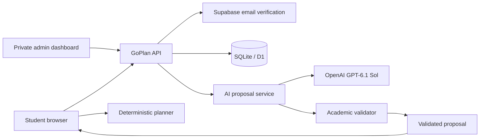

# Architecture

## Recommendation boundary

The model proposes decisions; it does not write directly to a student's saved roadmap. Academic choices are bounded by the reviewed dataset and checked after generation. The scheduler computes semester placement using prerequisites, credit caps and recorded progress. A changed roadmap is previewed before acceptance. At most one repair within the shared time and spending budget corrects rejected proposals; network failure does not silently produce fabricated advice.

## Academic sources

The applicable curriculum’s program sheet takes priority for explicit requirements, course choices, prerequisites and titles. The catalog fills facts the applicable sheet does not specify. Historical curricula do not overwrite newcomer requirements; explicit delegation of a minor to its providing school is preserved. Structured rules drive both scheduling and the course-details UI. The planner never appends supplementary prerequisite rows. Dependencies are allocated to unfilled, eligible free-elective slots with matching credits, retaining their own prerequisites and normal elective approval conditions. This never changes the degree course count or credit allocation. If an existing saved plan has filled those slots, a minimal replacement is offered as a draft; completed/current electives stay fixed. Unmet dependencies stay subject to normal validation. Older automatic rows are removed when a workspace is loaded, while any recorded study is retained outside the degree allocation.

## Research boundary

GPT-6 Luna runs focused native Responses web search without extra reasoning, required tool use, a low search context and at most two tool calls. Academic direction uses reviewed evidence unless live market refresh is explicitly enabled. Search and extraction share a 24-second budget; the complete request is limited to 55 seconds. Exact token counting and conservative reservations guard $0.20 of planned spending, including repairs and the Fast-mode premium used for target ranking. There are no automatic paid transport retries. D1 leases prevent simultaneous requests for the same authenticated student across Worker instances. Only completed web-search items establish consulted URLs. The server reads those public pages without provider credentials, validates redirects and exact short support fragments, then extracts facts under a strict JSON schema. Search prose alone is not a source receipt. Failed pages and unsupported claims are excluded. Exchange research enriches reviewed partner IDs without creating partnerships or confirming nomination. Raw search text and page bodies never enter the student response.

## Workspace boundary

Newcomers enter through three quick-choice question cards, then a dashboard of direction, courses, opportunities and semesters. Ready panels are local navigation and never trigger paid AI requests. One action can build the remaining plan; an edit router executes the relevant adviser stages across panels and produces a reviewable draft.

Returning students open their saved dashboard directly. They can edit degree, focus and minor without repeating onboarding, record course completion or current study, move a course, or swap a source-listed elective manually. Degree changes preserve their study record, check exact applicability and flag unmatched credit or a later finish. New account onboarding does not accept prior university study.

The dashboard exposes one active saved plan, direct edits and a clean start-over action. Course groups distinguish general education, common and major core, specialization, minor and elective requirements; each course links to its actual saved semester. Course details show resolved requirements only, omitting empty descriptions.

A workspace contains the planning decisions, saved and draft plans, progress and a small revision history. The server derives the owner from its authenticated session. Updates include an expected revision; a stale revision returns a conflict rather than overwriting newer work. Browser recovery copies are keyed by the verified account and workspace. They are not the authoritative cross-device store.

## Authentication boundary

A same-origin request asks Supabase to send an email code. GoPlan verifies the submitted code with Supabase, checks the confirmed email, and issues a five-minute HttpOnly setup cookie. A hashed, single-use database ticket gates password creation through Supabase. Normal sign-in uses Supabase password authentication; GoPlan then creates a random 256-bit session. Password resets revoke existing GoPlan sessions. Passwords and provider refresh tokens are never stored by GoPlan. Only a hash is stored in the database; the browser receives an HttpOnly, SameSite=Lax cookie with Secure enabled on HTTPS. Sessions expire after 30 days and are revoked on sign-out or GoPlan-data deletion. Temporary hashed rate-limit buckets bound email sends and verification attempts.

Legacy profiles are reconnected only after the same email is verified, and only when exactly one matching profile exists. The client cannot select another owner ID. The administrative allowlist is environment configuration, not frontend code. ChatGPT identity headers are not trusted by the new authentication path.

## Feedback and analytics

Reports are separate from identity-linked workspaces. Report receipts authorize a user's later withdrawal; they remain in the originating browser. A reviewer checks evidence, and only opted-in verified corrections enter later advice context. Daily operation counters contain no questionnaire, grade or plan payload. The student directory is separate from these counters and does not expose roadmap content.

## Portability

The HTTP handlers use Fetch API requests/responses and a small D1-style database interface. Development uses Node SQLite; the production builder embeds static assets in a Workers-compatible module. Hosting-specific deployment metadata is excluded from the public export. AI, auth and email services are runtime dependencies, not dependencies on the development assistant.
