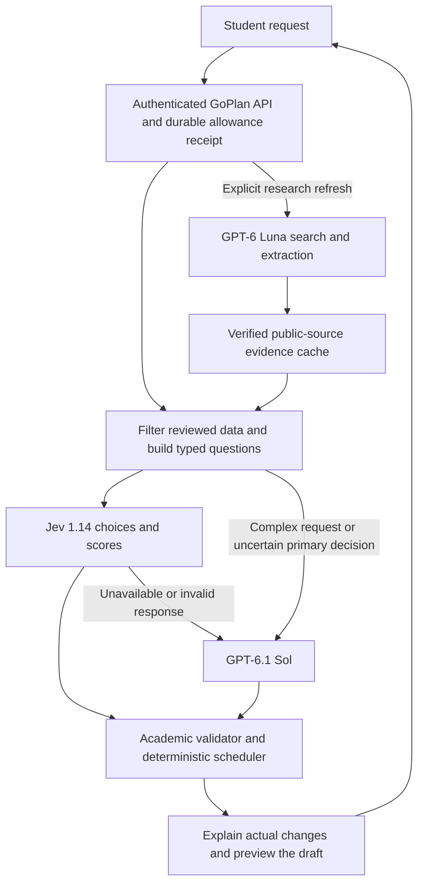

# Hybrid decision architecture

GoPlan owns the planning state, academic data and execution rules. Jev provides
bounded choices and relevance scores. Generative models handle research and
requests that need an explanation or broader interpretation.

## Routine requests

- Direction: choose a degree and focus from reviewed curricula; choose a
  complementary minor separately. An uncertain optional minor stays open.
  An uncertain primary degree decision falls back to Sol.
- Courses: GoPlan screens the eligible options and builds shortlists of at most
  24 courses per shared option set. Jev ranks each set once. Code allocates
  distinct courses to existing requirements and validates the complete result.
  Uncertain preference rankings use the existing preference-weighted baseline.
- Companies and exchanges: Jev scores the reviewed, profile-ranked candidate
  pools. GoPlan enforces named inclusions/exclusions, retained targets, distinct
  institutions and search tiers. Tied soft-fit scores use the profile ranking.
  Unavailable facts or a request outside the pool goes to the generative path.
- Pace: Jev chooses independent permitted regular and summer targets and the
  summer-study preference. Code applies eligibility and scheduling constraints.
- Global routing: Jev can route a clear request affecting one section. Mixed
  edits, changed goals and full rebuilds retain the existing Sol transaction.
- Exact recognized academic edits use the existing curriculum-backed code.

Student-facing explanations are assembled from selected preferences, reviewed
records and actual plan changes. Jev does not generate explanatory paragraphs.
Read-only questions, complex course/semester edits and other unhandled requests
retain the existing Sol path. Sol proposals pass the same academic validators.

## Research

With hybrid mode enabled, routine opportunity matching uses reviewed source
records immediately. It does not run live search before every shortlist.
Existing explicit `researchOnly: true` refreshes and explicit requests to research
online, refresh sources or verify availability still use Luna search, retrieval,
source receipts and extraction within the existing research deadline. Refreshed
facts are cached; a refresh does not silently replace a student's chosen list.
Ordinary matching never claims that an opening, exchange place or personal
eligibility has been confirmed. Research is demand-driven; no unattended refresh
job or new scheduler is created by this change.

## Configuration and rollback

Configure server-side runtime values:

| Key | Value |
| --- | --- |
| `GOPLAN_HYBRID` | `on` to enable; `off` to return to the original provider path |
| `TYPESAFE_API_KEY` | Secret, server-side only |
| `TYPESAFE_MODEL` | `jev-1.14.0`, pinned to the tested version |
| `GOPLAN_JEV_TIMEOUT_MS` | Default 5000 ms; bounded to 100–8000 ms |

Existing OpenAI credentials and research settings remain necessary for fallback
and research. If the Jev key is absent, the original path remains available.
After changing hosted environment values, deploy a saved version to apply them.
Never put credentials in browser assets, the hosting manifest or source history.

## Reliability and cost controls

The shared $0.25 backend-request spending guard includes Jev and any subsequent
OpenAI work. Each Jev attempt first reserves its full standard context ceiling,
then reconciles verified usage. Failed or ambiguous transports keep the reserve.
The client does not retry paid Jev requests. A short Jev timeout includes the
response body; the existing request deadline bounds the entire workflow.

Normal request and per-question contexts are bounded conservatively by UTF-8
bytes. No experimental long-context or image capability is enabled. Choice
membership, probability distributions, model identity and usage are checked.
Academic validity always comes from GoPlan's rules rather than a confidence score.

Durable receipts, account scoping, leases, protected completed/current study,
atomic global edits and lifetime allowances remain enforced. Provider selection
is part of cache scoping so a configuration change cannot reuse old advice.

Aggregate provider events contain model, outcome, token count, estimated Jev
cost and elapsed time. They omit prompts, answers, identity, grades and notes.
Total provider/token counters include both Jev and OpenAI. These events permit
measurement; they are not a statement of measured average student cost.

## Verification

`node verify-hybrid.mjs` runs synthetic protocol, four-stage planning, scoped
routing, persisted-workspace, timeout/failure fallback, shared-spending and
authenticated receipt-replay checks. `npm test` also runs the existing academic,
account, manual-edit and structural-transaction regressions. Offline providers
are fixtures; real provider access requires a separate controlled smoke test.

References: [TypeSafe introduction](https://docs.typesafe.ai/introduction),
[model contract and pricing](https://docs.typesafe.ai/models),
[confidence](https://docs.typesafe.ai/confidence),
[OpenAI API pricing](https://developers.openai.com/api/docs/pricing).
